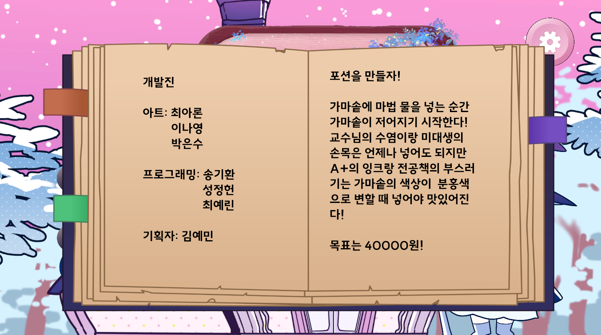
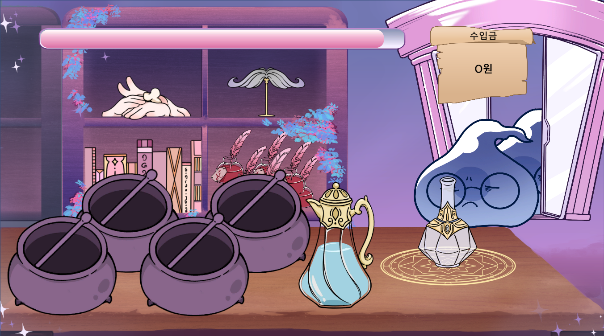
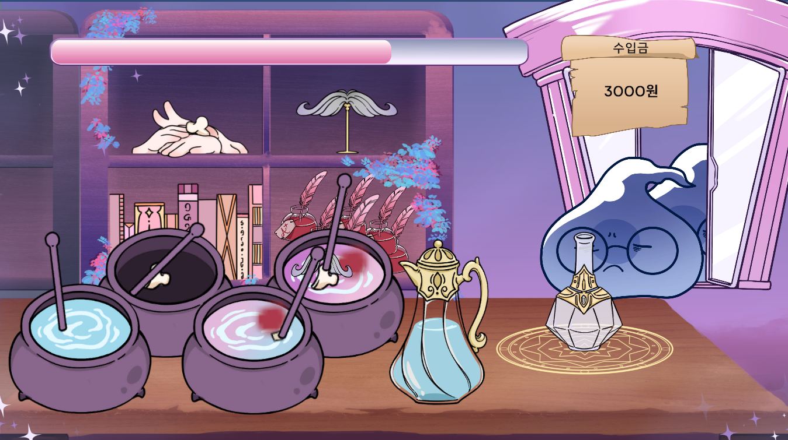
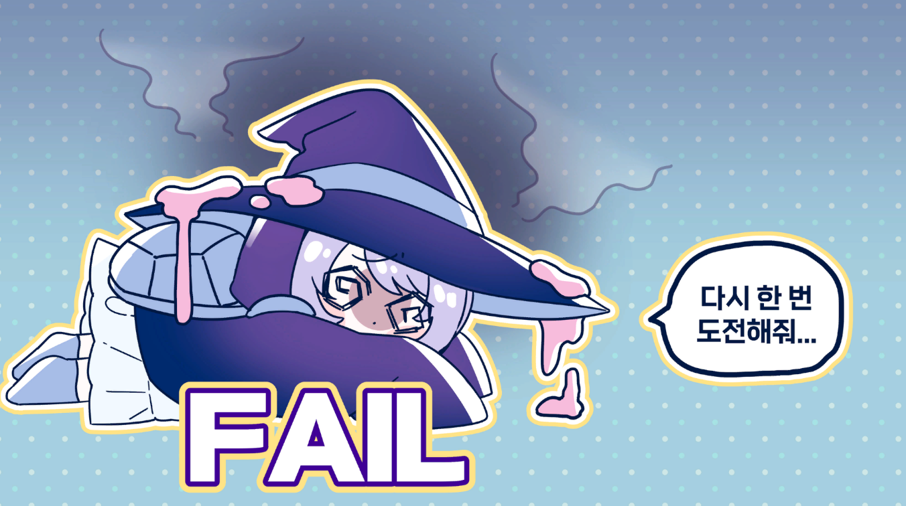
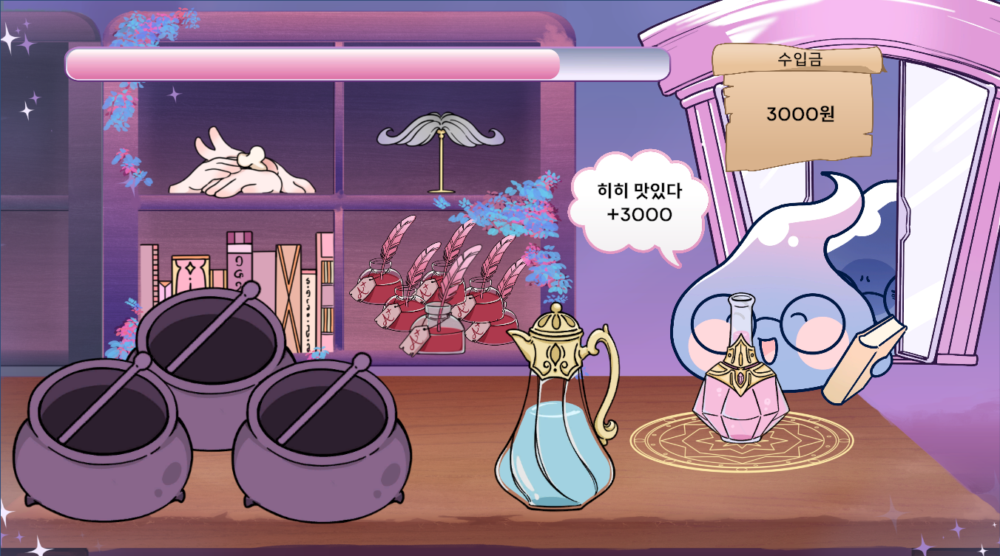

# unity2D-BugiPotionStore
25년도 후기 TeamODD 3일-게임잼

# 부기의 마법 포션 상점 (Boogie's Magic Potion Store)

**90초 제한 시간 내에 마법 물과 4종의 재료를 정밀한 타이밍에 조합해 손님에게 판매하는 Unity 2D 타임 매니지먼트 아케이드 게임**  
*(고전 플래시 게임 '슈의 라면가게'오마주 / Team ODD 3일 게임잼)*

**Original Team Repository (전체 소스 코드 및 커밋 내역)**: **[https://github.com/TeamODD/BugiPotionStore](https://github.com/TeamODD/BugiPotionStore)**  

---

### Gameplay Preview

| 스토리 & 메인 화면 | 인게임 대기 화면 | 실제 포션 조제 플레이 |
| :---: | :---: | :---: |
|  |  |  |

| 포션 조제 성공 (Good / Perfect) | 조제 실패 / 과부하 폭발 (Fail) | 라운드 종료 및 결과 화면 |
| :---: | :---: | :---: |
|  |  |  |

---

### 프로젝트 개요 & 팀 구성
* **개발 기간**: 3일 단기 집중 개발 (Day 1 코어 루프 → Day 2 판정·연출 통합 → Day 3 폴리싱 및 WebGL 빌드)
* **개발 환경**: Unity `6000.0.60f1 (LTS)`, C#, GitHub (`TeamODD` Organization)
* **팀 구성 (Team ODD: 균형)**
  * **프로그래밍 (3인)**: **송기환 (코어 루프·상태머신·씬 총괄 리드)** / 최예린 (섞임 타이머·판정 로직) / 성정헌 (UI·튜토리얼·사운드 매니저)
  * **아트 (3인)**: 최아론 (캐릭터·배경) / 박은수 (UI·UX) / 이나영 (재료·유리병 단계별 오브젝트)
  * **기획 (1인)**: 김예민 (게임 플로우, 밸런스, 레퍼런스 및 사운드 디렉팅)

---

### 게임 규칙 및 코어 플로우 (Game Loop)

1. **90초 라운드 타임 어택**: 시작과 동시에 90초 타이머가 작동하며, 제한 시간 내에 최대한 많은 골드를 획득하는 것이 목표입니다.
2. **10초 조제 사이클 & 타이밍 판정**:
   * **마법 물 투입 (`0s`)**: 유리병에 마법 물을 붓는 즉시 자동 섞임 타이머(총 10초)가 가동됩니다.
   * **일반 재료 2종** *(교수님의 머리카락, 미대생의 손목)*: 조제 중 언제든 투입 가능합니다.
   * **특별 재료 2종** *(전 A+의 잉크방울, 공책 부스러기)*: 물이 적정 농도로 섞이는 **5–7초 골든타임** 구간에 투입해야 최고 등급이 완성됩니다.
   * **단계별 상태 변화 & 실패 조건**: 시간 경과에 따라 유리병 색상이 `투명 → 파랑 → 분홍 → 보라`로 변하며, `Under(거절)` / `Good(+500G)` / `Perfect(+1,000G)` / `Over(전달 불가)`로 판정됩니다. 10초 초과 방치 시 마력 과부하로 유리병이 깨지며 실패 처리됩니다.

---

### 담당 역할 및 핵심 구현 (Programming Lead)

프로그래밍 리드로서 **전체 게임 상태 머신(FSM) 아키텍처 설계, 씬 전환, 손님 루프 및 팀원 간 코드 통합**을 전담했습니다.

1. **계층적 게임 상태 머신 및 씬 루프 총괄 (`Title → Ready → Play → Judge → Result`)**
   * 라운드 시작 대기(`Ready`), 90초 인게임 진행(`Play`), 포션 제출 판정(`Judge`), 최종 골드 정산 및 재시작(`Result`)으로 이어지는 전체 게임 생명주기를 상태 머신으로 구조화하여 상태 꼬임 방지
2. **손님 대기열 및 상호작용 파이프라인 구현**
   * 손님 등장 및 대기열 관리, 포션 전달 시 판정 등급(`Under / Good / Perfect / Over`)에 따른 손님 반응 애니메이션(`만족 / soso / 실망`) 및 퇴장 루프 연결
   * 실패(유리병 과부하 폭발) 및 90초 타임아웃 발생 시 진행 중인 입력과 타이머를 안전하게 정리하는 예외 루트 처리
3. **3일 스프린트 협업 및 GitHub 코드 통합 관리**
   * 짧은 개발 기간 내 3인 프로그래머와 3인 아트 파트의 리소스가 충돌 없이 병합될 수 있도록 스크립트·폴더 네이밍 규칙과 머지 전 백업 워크플로우를 수립하고 통합 빌드 주도

---

### 관련 링크
* **팀 원본 레포지토리 (소스 코드 확인)**: [TeamODD/BugiPotionStore](https://github.com/TeamODD/BugiPotionStore)
* **개발자 프로필 홈**: [thdrlghks GitHub Profile](https://github.com/thdrlghks)
